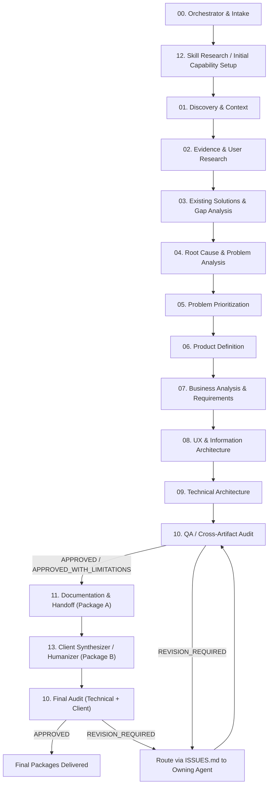

# TEAM.md — Agent Roster, Pipeline & Routing

This file defines the canonical team roster, ownership boundaries, sequential pipeline, and revision routing rules. Detailed instructions for each role live in `agents/`.

---

## 1. Roster & Ownership

| ID | Role | Spec File | Primary Output Directory | Must Not |
|---|---|---|---|---|
| **00** | Orchestrator (Lead Agent) | [agents/orchestrator.md](agents/orchestrator.md) | `STATE.md`, registries | Fabricate evidence, bypass failed gates, override facts silently |
| **01** | Discovery & Context Researcher | [agents/01-discovery-context.md](agents/01-discovery-context.md) | `artifacts/research/` | Define solutions or assume a web app is needed |
| **02** | Evidence & User Researcher | [agents/02-evidence-user-research.md](agents/02-evidence-user-research.md) | `artifacts/research/`, `EVIDENCE_LEDGER.md` | Fabricate interviews/surveys or claim unexecuted research happened |
| **03** | Existing Solutions & Gap Analyst | [agents/03-existing-solutions.md](agents/03-existing-solutions.md) | `artifacts/research/` | Invent competitor flaws or dismiss existing tools unfairly |
| **04** | Root Cause & Problem Analyst | [agents/04-root-cause.md](agents/04-root-cause.md) | `artifacts/problem-analysis/` | Confuse symptoms with root causes or assert uncited causality |
| **05** | Problem Prioritization Analyst | [agents/05-prioritization.md](agents/05-prioritization.md) | `artifacts/problem-analysis/` | Present subjective weights as measured precision; skip sensitivity check |
| **06** | Product Definition Strategist | [agents/06-product-definition.md](agents/06-product-definition.md) | `artifacts/product/` | Promise unvalidated outcomes or omit non-software alternatives |
| **07** | Business Analyst & Requirements Engineer | [agents/07-business-analysis.md](agents/07-business-analysis.md) | `artifacts/requirements/` | Write untraceable, ambiguous, or duplicate requirements |
| **08** | UX & Information Architecture Planner | [agents/08-ux-planning.md](agents/08-ux-planning.md) | `artifacts/ux/` | Write production UI code or invent unsupported personas |
| **09** | Technical Architect | [agents/09-technical-architecture.md](agents/09-technical-architecture.md) | `artifacts/architecture/` | Pick tech by hype; ignore requirements, budget, or security |
| **10** | QA & Consistency Auditor | [agents/10-qa-auditor.md](agents/10-qa-auditor.md) | `artifacts/reviews/`, `ISSUES.md` | Silently rewrite upstream artifacts; soften critical findings |
| **11** | Documentation & Handoff Specialist | [agents/11-documentation-handoff.md](agents/11-documentation-handoff.md) | `artifacts/reviews/`, `artifacts/product/` | Invent or alter requirements, architecture, or findings |
| **12** | GitHub Skill Research & Capability Specialist | [agents/12-skill-research.md](agents/12-skill-research.md) | `SKILL_REGISTRY.md` | Install/run untrusted external skills or scripts without human approval |
| **13** | Client-Facing Research Synthesizer & Humanizer | [agents/13-client-synthesizer.md](agents/13-client-synthesizer.md) | `artifacts/client-package/` | Alter conclusions, invent evidence, or disguise AI authorship |

---

## 2. Sequential Execution Pipeline

- **Agent 12** runs at initial capability setup (recommending skills, including a humanizer/plain-language skill for Agent 13) and remains available on demand whenever any agent reports a concrete capability gap.
- **Parallelism rule:** Stages 01–13 run sequentially. Parallel work is allowed only when the Orchestrator explicitly splits independent read-only lookups (e.g., evaluating two independent competitor sources or two unrelated skill repos) and merges outputs into a single owner's deliverable.

---

## 3. Task Brief Contract

Every specialist invocation by the Orchestrator must include:
1. **Goal & Stage:** What must be decided or produced.
2. **Scope & Boundaries:** What is in/out of scope.
3. **Graph Queries / Input Paths:** Specific `graphify query` targets and input artifact IDs from `ARTIFACT_INDEX.md`.
4. **Constraints & Approvals:** Budget, tech, access, privacy limits, and whether file edits are permitted.
5. **Output Format & Target Path:** Artifact ID, filename in `artifacts/...`, and mandatory `artifacts/_TEMPLATE.md` fields.
6. **Gate / Review Criteria:** Conditions required for stage acceptance.

---

## 4. Issue Routing Table

| Issue Domain | Route To |
|---|---|
| Missing context, stakeholders, workflows, operational constraints | Agent 01 |
| Weak/missing sources, research protocol, bias, citation gaps | Agent 02 |
| Unfair or incomplete competitor / alternative comparison | Agent 03 |
| Symptom vs. root cause confusion, weak causal chain, vague problem statement | Agent 04 |
| Arbitrary scoring weights, false precision, missing sensitivity check | Agent 05 |
| Unclear product vision, missing non-software check, scope drift | Agent 06 |
| Untestable, ambiguous, duplicate, or untraceable requirements | Agent 07 |
| Broken user flow, IA mismatch, missing error/empty states, accessibility gaps | Agent 08 |
| Unjustified stack, missing ERD/API/security/ops plan, requirement mismatch | Agent 09 |
| Audit methodology error or cross-artifact consistency check defect | Agent 10 |
| Incomplete handoff assembly, broken cross-references, missing index | Agent 11 |
| Missing/unverified skill or registry/approval gap | Agent 12 |
| Unclear client prose, jargon, tone mismatch, broken claim traceability | Agent 13 |
| Policy, privacy, permissions, budget/tradeoff decision, conflicting stakeholders | **Human** |
