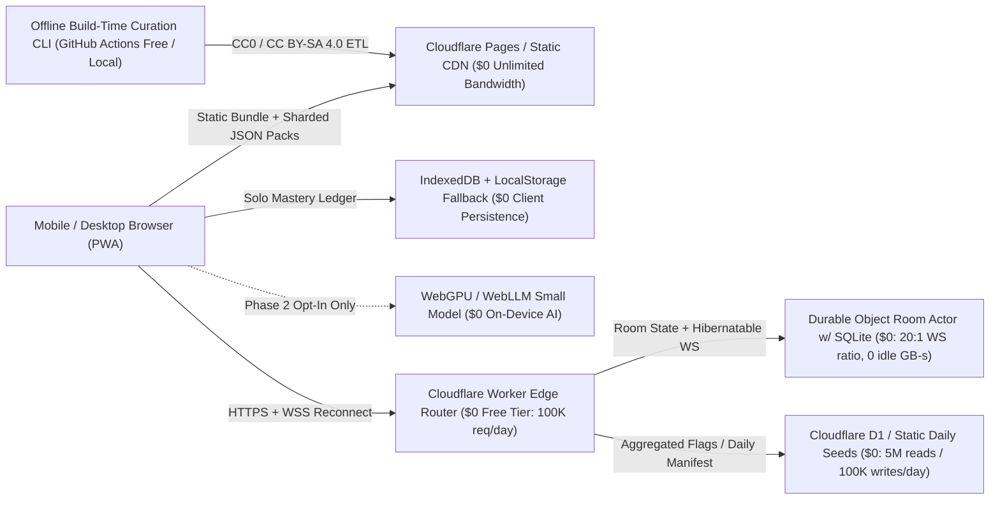
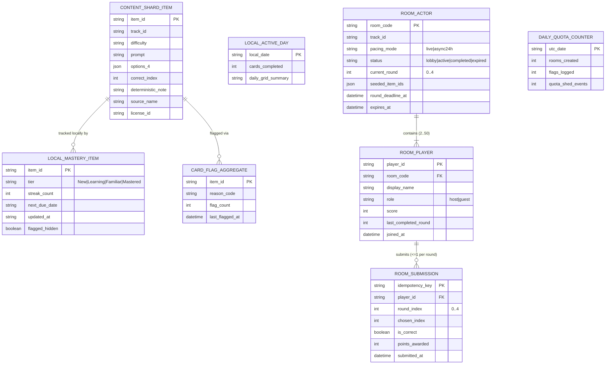

# ART-009 — Stage 09 Technical Architecture Specification

| Field | Value |
|---|---|
| **Artifact ID** | `ART-009` |
| **Purpose** | Define the end-to-end `$0`-cost technical architecture (`ARC-NNN`), stack rationale, data model & ERD, API/WebSocket contracts, security & privacy threat model, deployment/quota operations plan, and requirement traceability for `PRB-005`. |
| **Status** | `approved` |
| **Owner** | `Agent 09 (Technical Architect)` |
| **Revision** | `v1.1` *(Fixed `ISS-001`: added `DAILY_QUOTA_COUNTER` to ERD and removed undefined `POST /api/daily/check` reference)* |
| **Date Created** | `2026-11-19` |
| **Date Updated** | `2026-11-19` |
| **Sources / Input Artifacts** | `ART-006` (`GOAL-001`..`GOAL-005`), `ART-007` (`REQ-001`..`REQ-012`, `REQ-NFR-001`..`REQ-NFR-007`), `ART-008` (`UX-001`..`UX-005`), `DECISIONS.md` (`DEC-008`, `DEC-009`), `EVIDENCE_LEDGER.md` (`SRC-022`, `SRC-029`, `SRC-030`, `FND-013`, `FND-015`, `FND-016`), `SKL-010a` (`writing-plans`) |

---

## Assumptions & Limitations

- **Strict `$0` constraint (`DEC-009`):** Architecture forbids paid managed databases, paid auth SaaS, paid cloud LLM APIs, and paid hosting plans. Free-tier hard-stop quotas (`100K` Worker/DO requests/day, `13,000` GB-s/day, `5 GB` SQLite storage; `SRC-030`) are treated as hard architectural boundaries.
- **No implementation code written:** Per `AGENTS.md`, `app/` code is out of scope during discovery; this document specifies module boundaries, contracts, and schemas ready for Package A handoff.
- **Traffic headroom estimate:** Request-per-room figures (`Section 6`) are engineering calculations grounded in verified Cloudflare billing rules (`FND-016`), not live production telemetry.

---

## Content

### 1. System Architecture Overview & Component Boundaries

The system splits cleanly into **three `$0` runtime tiers** so solo daily play consumes zero server compute after static CDN caching, while multiplayer rooms get deterministic, reconnect-safe edge actors:

#### Component Responsibilities
1. **Static Client & Local Mastery Engine (`PWA` on Cloudflare Pages):**
   - Lightweight TypeScript SPA (`< 250 KB` gzipped target, `REQ-NFR-001`), Service Worker offline cache for Solo Daily + Practice packs, `IndexedDB` spaced-repetition engine (`REQ-002`) with schema versioning + checksummed JSON/string backup (`REQ-009`).
2. **Offline Open-Corpus Curation Pipeline (Build-Time CLI / Free CI):**
   - Deterministic Node/Python ETL ingests `Tatoeba CC0`, `Wikidata CC0`, `Wiktionary CC BY-SA 4.0`, and `OpenTriviaDB CC BY-SA 4.0` (`SRC-029`), normalizes/unescapes text, deduplicates prompts, generates plausible deterministic distractors, verifies license metadata (`REQ-007`, `REQ-NFR-007`), and emits static versioned JSON shards + UTC-keyed daily seed manifests.
3. **Edge API Router (`Cloudflare Worker`):**
   - Serves `/api/daily/:date/:track` (CDN-cached `24h+`), validates room creation/join payloads, enforces per-IP/session rate limits (`REQ-010`), verifies HMAC-SHA256 room tokens via WebCrypto, and routes room traffic to the room's Durable Object instance.
4. **Stateful Room Actor (`Cloudflare Durable Object` w/ SQLite + WebSocket Hibernation):**
   - One isolated Durable Object per active room (`6-char` code), holding authoritative round state, timer deadlines (DO Alarms), participant roster, and idempotency keys (`REQ-005`, `REQ-006`). Uses **WebSocket Hibernation API** so idle rooms incur `0 GB-s` duration and incoming WS messages count at `20:1` (`FND-016`). Auto-schedules a `48h` cleanup alarm (`REQ-NFR-005`).
5. **Lightweight Flag & Telemetry Store (`Cloudflare D1`):**
   - Stores only aggregated card-flag counts (`REQ-008`) and daily room-creation counters (`REQ-010`)—zero PII, zero personal mastery rows.
6. **Optional Local AI Adapter (`Phase 2` WebGPU / WebLLM):**
   - Lazy-loaded module detecting `navigator.gpu` + user opt-in (`REQ-011`); falls back cleanly to pre-packaged deterministic open-metadata explanations (`0%` gameplay dependence).

---

### 2. Architecture Decision Records (`ARC-NNN`) & Stack Evaluation

| ARC ID | Decision | Chosen Option | Alternatives Evaluated & Rejected | Rationale (Constraints `DEC-008`, `DEC-009`, `FND-016`) |
|---|---|---|---|---|
| **ARC-001** | **Hosting, Edge Runtime & Real-Time State** | **Cloudflare Pages + Workers + SQLite-backed Durable Objects (WebSocket Hibernation)** | - *Managed VPS / Fly.io / Render:* Free tiers sleep aggressively (cold-start WebSocket drops) or require credit card / paid tier for reliable stateful rooms. - *Supabase Realtime / Firebase:* Per-connection / MAU / bandwidth caps harder to bound for `30+` player bursty rooms without SQLite actor isolation. | Zero-cost static bandwidth (`Pages`), single-writer SQLite state per room (`DO`) eliminating race conditions, and WebSocket Hibernation (`0` idle duration + `20:1` incoming msg billing) directly match solo backend reliability strengths at `$0` (`SRC-030`). |
| **ARC-002** | **Personal Mastery Persistence** | **Client-Local `IndexedDB` (w/ `localStorage` fallback) + Portable Checksummed Export/Import** | - *Centralized User Accounts + Postgres/D1:* Requires auth/OAuth/password reset ops, PII storage, GDPR burden, and burns free-tier DB writes on every solo card flip. | Eliminates auth friction (`REQ-004`), guarantees zero-PII privacy (`REQ-NFR-005`), and keeps solo play at `0` server DB writes (`GOAL-004`). |
| **ARC-003** | **Content Delivery & Daily Seeds** | **Static Build-Time Sharded JSON Packs + Deterministic Seeded PRNG (`hash(utcDate + trackId + serverSalt)` or static daily manifest)** | - *Live Runtime DB Query per Card:* Wastes D1 row reads on every card and adds latency. - *Runtime LLM Question Generation:* Violates `$0` cost and risks hallucinations. | `Cache-Control: immutable` versioned shards cost `0` Worker requests on repeat visits and work offline in PWA cache (`REQ-NFR-001`). |
| **ARC-004** | **Multiplayer Reliability & Anti-Spoiler Protocol** | **Server-Authoritative DO State Machine + Signed HMAC Tokens (`WebCrypto`) + `(roundIdx, idempotencyKey)` Deduplication** | - *Client-Trusted Score / P2P WebRTC-only in MVP:* WebRTC NAT traversal requires TURN servers (costs money!) and fails on strict mobile/corporate networks; client-trusted state leaks answer keys (`TEST-005`). | Server-side DO strips `correctIndex` until `round_revealed`/`async_submitted`, and signed `playerToken` enables seamless mobile Wi-Fi/LTE reconnect hydration (`REQ-006`). |
| **ARC-005** | **Dev Tooling, Repo & CI/CD** | **TypeScript + Vite/Preact (or SvelteKit static) + Vitest + Playwright + GitHub Free + GitHub Actions Free** | - *Heavy SSR Frameworks / Paid SaaS CI / Paid Monitoring:* Inflates bundle past `250 KB` or introduces paid tiers. | All open-source MIT/Apache tools; static bundle `< 250 KB` gzipped (`REQ-NFR-001`); GitHub Actions runs build-time corpus checks & Pages/Worker deploys at `$0`. |
| **ARC-006** | **Optional Local AI (`Phase 2`)** | **Progressive-Enhancement `WebLLM` (`WebGPU`) Adapter Behind Explicit User Opt-In** | - *Mandatory WebGPU or Free-Tier External LLM Proxy:* Breaks Firefox Android / older iPhones (`SRC-022`) or risks sudden API key abuse/billing. | Satisfies `GOAL-005` cleanly: `100%` deterministic MVP without AI, zero cloud LLM spend ever. |

---

### 3. Data Model & Entity-Relationship Diagram (ERD)

Split cleanly across **Client-Local Storage (`IndexedDB`)**, **Static CDN Packs**, **Edge Durable Object (`SQLite` per room)**, and **Edge Global (`D1`)**:

*Note:* `ROOM_ACTOR` keeps `seeded_item_ids` and resolves `correct_index` inside the Worker/DO from bundled shard index data—never sending `correct_index` to clients before reveal (`REQ-NFR-006`).

---

### 4. API & Real-Time WebSocket Contract

#### HTTP Endpoints (`Cloudflare Worker`)
| Endpoint | AuthN / AuthZ | Request / Validation | Response & Caching |
|---|---|---|---|
| `GET /api/daily/:utcDate/:track` | Public | `utcDate` (`YYYY-MM-DD`), `track` enum | Returns the deterministic 5-item manifest for Solo Daily offline-capable play (referencing items in CDN-cached static shards); cached `24h` at CDN edge (`REQ-010`). |
| `POST /api/rooms` | Public + IP rate limit (`<= 10` rooms/IP/hr) | `{ trackId, pacingMode: "live"|"async24h", maxPlayers: 2..50, hostName }` | Creates DO room, returns `{ roomCode, hostToken (HMAC-SHA256), playerToken }`. Returns `503` w/ friendly solo fallback if daily quota guard (`>= 85%`) triggers (`REQ-010`). |
| `POST /api/rooms/:code/join` | Public + room rate limit | `{ displayName (2..20 chars sanitized) }` OR `{ playerToken }` for reconnect | Validates capacity (`<= maxPlayers`), disambiguates duplicate names, returns `{ playerToken, roomStateHydration }` (`REQ-004`, `REQ-006`). |
| `GET /api/rooms/:code/hydrate` | `Bearer playerToken` (HMAC verified) | Header token | Returns current room phase, player scores, completed round summaries, and current round prompt (sans pre-reveal `correctIndex`). |
| `POST /api/flags` | Public + session/IP cap (`<= 5`/day) | `{ itemId, reasonCode: "typo"|"ambiguous"|"wrong_answer"|"offensive" }` | Increments `CARD_FLAG_AGGREGATE` in D1 (`1` upsert); returns `202 Accepted` (`REQ-008`). |

*\*Anti-spoiler boundary (`REQ-NFR-006`, `TEST-005`):* Solo offline practice evaluates answers locally against CDN static shards (`$0` server cost), whereas **all Multiplayer Room modes (`Live` and `24h Async`)** strip `correctIndex` and `deterministicNote` on the server Durable Object until `round_revealed` or individual `submit_answer` ack.

#### WebSocket Events (`/api/rooms/:code/ws?token=playerToken`)
- **Client -> Server:**
  - `host_start_round` (verified `role === "host"`, Live Sync only)
  - `submit_answer` `{ roundIndex, chosenIndex, idempotencyKey }` (idempotent in `ROOM_SUBMISSION` SQLite table; `Async24h` also accepts HTTP `POST /api/rooms/:code/answer` so mobile async users don't even need a persistent socket!)
- **Server -> Client:**
  - `room_state` (on connect/reconnect hydration — exact round, timer deadline, roster)
  - `round_started` `{ roundIndex, prompt, options, deadlineEpochMs }`
  - `player_progress` `{ playerId, answered: true }` (no answer leak)
  - `round_revealed` `{ roundIndex, correctIndex, deterministicNote, playerResults[] }`
  - `room_completed` `{ finalStandings[], shareGridData }`

---

### 5. Security, Privacy & Threat Analysis

| Threat / Attack Vector | Likelihood / Impact | Concrete Mitigation |
|---|---|---|
| **Pre-Reveal Answer Leakage (Cheating in Rooms)** | Medium / High | `correctIndex` and `deterministicNote` never leave the Durable Object before `round_revealed` (`Live`) or individual `submit_answer` ack (`Async24h`). Tested via `TEST-005`. |
| **Free-Tier Quota Exhaustion / Room Spam (`$0` DoS)** | High / High | Per-IP sliding-window rate limits in Worker/DO (`<= 10` rooms/hr/IP, `<= 30` WS msgs/min/player), max `50` players/room, `<= 5` flags/day, plus internal daily counter shutting off new rooms cleanly at `85%` of `100K` daily quota (`REQ-010`). |
| **Display Name XSS / Profanity Abuse** | High / Medium | Strict plain-text rendering (React/Preact text nodes, zero `dangerouslySetInnerHTML`), `2–20` char length cap, control-char/URL strip, basic client+server profanity blocklist; bring-your-own-group invite links (`6-char` high-entropy room code) prevent public stranger discovery. |
| **Duplicate Score / Race Condition on Mobile Reconnect** | High / High | SQLite transaction inside single-threaded Durable Object checking `PRIMARY KEY (idempotency_key)` and `UNIQUE (player_id, round_index)` (`REQ-006`, `REQ-NFR-002`). |
| **Token Forgery (`hostToken` / `playerToken`)** | Low / High | Stateless HMAC-SHA256 signed JWT/compact tokens using Worker `SECRET_KEY` (stored as Cloudflare Worker secret at `$0`) with `roomCode`, `playerId`, `role`, and `exp <= 48h`. |
| **CC BY-SA 4.0 License Non-Compliance** | Medium / Medium | Separate `CC0` vs `CC BY-SA 4.0` packs in build manifest; render mandatory attribution on `/about` and pack metadata; host curated trivia JSON packs openly in repo (`REQ-NFR-007`). |

---

### 6. Deployment, `$0` Quota Budget, Backup & Operations Plan

#### Deployment Pipeline (`$0`)
- **Source & CI:** GitHub free repository + GitHub Actions free tier runs `npm test` (Vitest unit + deterministic curation checks), Playwright mobile viewport/a11y smoke tests, and deploys static build to **Cloudflare Pages** + edge scripts to **Cloudflare Workers**.
- **Environments:** Local `wrangler dev` + `vitest` (`$0`) -> Cloudflare Pages preview URLs (`$0`) -> Production (`$0`).

#### `$0` Production Quota Math (Verified Against `SRC-030` / `FND-016`)
- **Cloudflare Pages:** Unlimited static bandwidth (`$0`). Solo Daily + Practice play = **0 Worker/DO requests** once cached!
- **Cloudflare Workers + Durable Objects (`100,000` counted requests/day free, `13,000` GB-s/day free):**
  - *Live 10-player 5-round room:* `1` create + `10` joins + `10` WS upgrades + `~60` incoming WS msgs (counted at `20:1` = `3` billed reqs) + `5` DO alarm ticks = **`~29` counted requests/room**.
  - *Capacity at `85%` safety cap (`85,000` reqs/day):* **~2,900 live 10-player rooms/day** (or **~1,000+ 30-player rooms/day**) completely at **`$0/month`**, with idle WebSocket Hibernation incurring `0` idle GB-s duration!
- **Cloudflare D1 (`5M` reads/day, `100K` writes/day free):**
  - Used only for `CARD_FLAG_AGGREGATE` (`<= 5`/user/day) and coarse daily quota counters—easily `< 5%` of daily write quota.

#### Backup, Observability & Cleanup
- **Ephemeral Room Data:** DO Alarm automatically calls `ctx.storage.deleteAll()` `48h` after room completion/inactivity (`REQ-NFR-005`).
- **User Mastery Data:** Client-owned (`IndexedDB`) + 1-click user-initiated JSON/sync-string export (`REQ-009`).
- **Curated Content Packs:** Git-versioned in repository + static CDN fallback (`$0` backup).
- **Observability (`$0`):** Structured JSON console logs in Workers (viewed live via `wrangler tail`) + minimal D1 daily counter rollup (`rooms_created`, `flags_logged`, `quota_shed_events`)—no paid APM/Sentry SaaS needed in MVP.

---

### 7. Architecture-to-Requirement Traceability (`REQ-NNN <-> ARC-NNN`)

| Requirement(s) | Supporting Architecture Component(s) |
|---|---|
| `REQ-001`, `REQ-002`, `REQ-003` | Static PWA + Local Mastery Engine (`ARC-002`, `ARC-003`, `ARC-005`) |
| `REQ-004`, `REQ-005`, `REQ-006`, `REQ-NFR-002`, `REQ-NFR-006` | Edge Worker Router + Durable Object SQLite Room Actor w/ WS Hibernation + HMAC Tokens + Idempotency Keys (`ARC-001`, `ARC-004`) |
| `REQ-007`, `REQ-008`, `REQ-NFR-007` | Build-Time Open-Corpus Curation CLI (`CC0`/`CC BY-SA 4.0`) + D1 `CARD_FLAG_AGGREGATE` (`ARC-003`, `ARC-005`) |
| `REQ-009`, `REQ-NFR-005` | Client-Local `IndexedDB` + Checksummed Export/Import + `48h` DO `deleteAll()` TTL (`ARC-002`, `ARC-001`) |
| `REQ-010`, `REQ-NFR-001` | Cloudflare Pages CDN Cache + Worker Rate Limiter + `85%` Quota Shedding (`ARC-001`, `ARC-003`) |
| `REQ-011` (`Phase 2`), `GOAL-005` | Opt-In WebGPU / WebLLM Client Adapter w/ Deterministic Fallback (`ARC-006`) |
| `REQ-NFR-003`, `REQ-NFR-004` | Static PWA UI Layer (`100dvh`, `touch-action`, WCAG 2.1 AA semantics in `ART-008` / `ARC-005`) |

---

## Next Steps / Unresolved Issues

- **Stage 09 Gate Check:** Every functional and non-functional `REQ-NNN` maps to concrete `ARC-NNN` components; stack choices are strictly justified by `$0` dev/prod/deploy constraints (`DEC-009`) and solo backend strengths; ERD, API/WS contracts, security threat analysis, quota math, and ops/backup plans are complete.
- **Next Stage:** Hand off to **Agent 10 (QA & Consistency Auditor)** via `workflows/review.md` for the mandatory **Post-Stage 09 Cross-Artifact QA Audit** before assembling Package A (`Agent 11`) and Package B (`Agent 13`).
